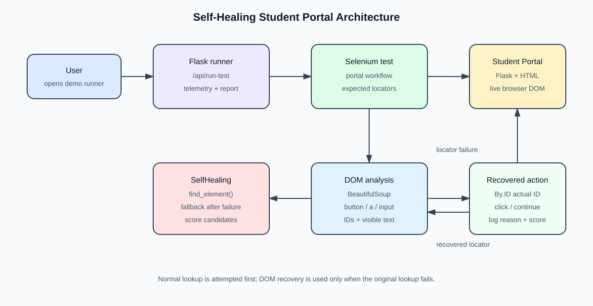
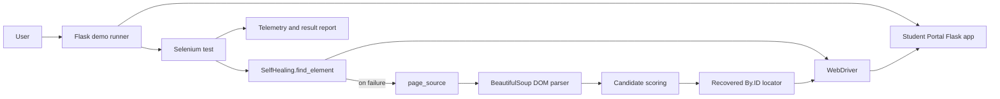
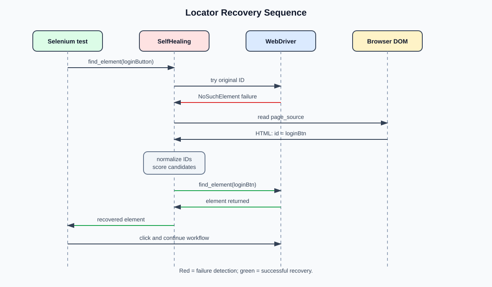
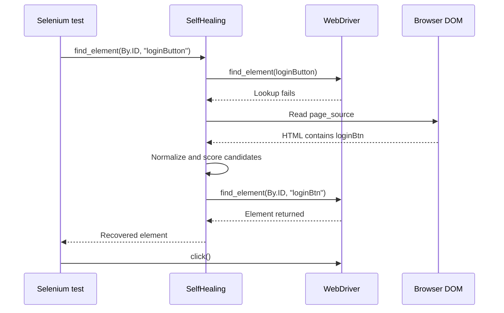
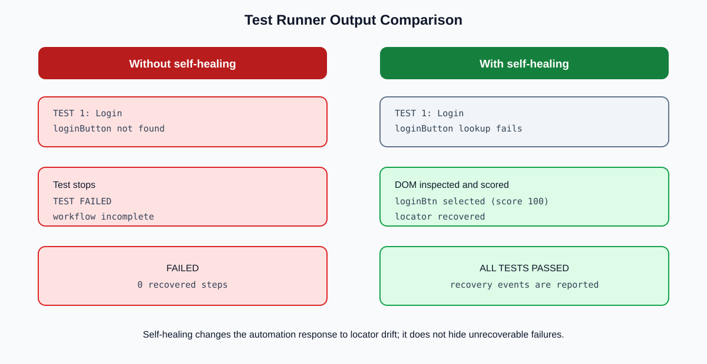
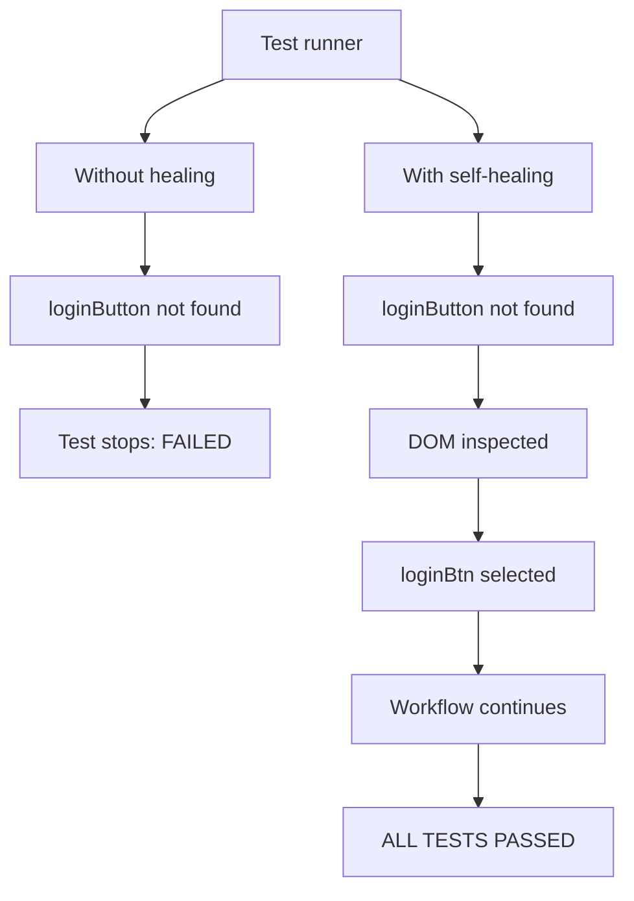

# Self-Healing Student Portal

## 1. Project overview

This project is a Flask-based **Student Portal** with an automated Selenium test suite. The portal provides:

- A login page with demo credentials.
- A protected dashboard.
- Profile, products, and settings pages.
- Logout functionality.
- A browser-based test runner that compares testing **without self-healing** and **with self-healing**.

The main goal is to demonstrate how an automated UI test can recover from a small, realistic change in a web page: an element's locator (for example, its `id`) no longer matches the locator stored in the test.

### Technologies used

| Area | Technology |
|---|---|
| Web application | Python, Flask, Jinja templates |
| Browser automation | Selenium WebDriver |
| DOM analysis | BeautifulSoup |
| Test interface | Flask API and `demo.html` |
| Recovery strategy | Heuristic candidate scoring |

Important project files are [app.py](../app.py), [healer.py](../self_healing/healer.py), [test_student_portal.py](../tests/test_student_portal.py), and [test_without_healing.py](../tests/test_without_healing.py).

## 2. What the application does

The application models a simple student portal. A user signs in, visits different sections, and logs out. The expected workflow is:

1. Open the login page.
2. Enter `admin` and `admin123`.
3. Submit the form and reach the dashboard.
4. Open Profile.
5. Open Products.
6. Open Settings.
7. Log out and return to the login page.

The portal intentionally contains locator variations to create a controlled demonstration:

| Page/state | Test expects | Actual HTML | Result |
|---|---|---|---|
| Login button | `loginButton` | `loginBtn` | Recovered |
| Dashboard Profile link | `profileLink` | `profileBtn` | Recovered |
| Products Settings link | `settingsLink` | `settingsbtn` | Recovered |
| Other links | Matching IDs | Matching IDs | Found normally |

These are not application failures. They simulate **locator drift**, where the UI still works for a human but an older automated test can no longer find an element.

## 3. What self-healing means theoretically

Traditional UI automation uses a fixed locator:

```python
driver.find_element(By.ID, "loginButton")
```

If the HTML changes from `loginButton` to `loginBtn`, Selenium raises `NoSuchElementException` and the test stops. A self-healing test adds a recovery loop:

1. **Observe:** Try the original locator.
2. **Detect:** Catch the locator failure.
3. **Inspect:** Read the current page DOM.
4. **Generate candidates:** Search relevant interactive elements.
5. **Score candidates:** Compare IDs and visible text with the failed locator.
6. **Select:** Choose the highest-scoring candidate.
7. **Recover:** Build a new usable Selenium locator and continue the test.
8. **Report:** Print the original locator, recovered locator, score, and reason.

The current project uses deterministic heuristics rather than a machine-learning model. For the ID `loginButton`, it removes common words such as `button`, `link`, and `btn`, then compares the normalized forms:

```text
loginButton -> login
loginBtn    -> login
```

The implementation also checks semantic text such as `Login`, `Profile`, and `Settings`. This makes the recovery explainable: a candidate is selected because it has a similar ID pattern and/or matching visible text.

### Scope and limitations

This demonstration heals simple locator changes. It does not claim that every UI failure can be repaired automatically. A production-grade system would also need:

- More locator types, including CSS selectors, XPath, classes, and attributes.
- Stronger uniqueness checks before clicking a candidate.
- Confidence thresholds and an explicit unsafe-recovery state.
- Screenshots, structured logs, and recovery history.
- Protection against selecting a visually similar but semantically wrong element.
- A policy for updating or reviewing the original test locator.

## 4. Self-healing implementation: important code blocks

### 4.1 Wrapper around Selenium lookup

The `SelfHealing` class keeps the normal Selenium lookup as the first choice. Recovery is only attempted after the original lookup fails.

```python
class SelfHealing:

    def __init__(self, driver):
        self.driver = driver

    def find_element(self, by, value):
        try:
            return self.driver.find_element(by, value)
        except Exception:
            print("SELF-HEALING ACTIVATED")
            print(f"Original locator failed: {by} = {value}")
```

This preserves normal test behavior and limits the extra work to a failure path.

### 4.2 Reading the live DOM

After a failure, the current browser DOM is parsed. Only interactive element types used by this project are considered.

```python
soup = BeautifulSoup(
    self.driver.page_source,
    "html.parser"
)

candidates = []

for element in soup.find_all(["button", "a", "input"]):
    element_id = element.get("id")
    element_name = element.get("name")
    text = element.get_text(strip=True)
```

### 4.3 Heuristic ID similarity

The project normalizes common naming suffixes before comparing the expected and actual IDs.

```python
original_clean = (
    value.lower()
    .replace("button", "")
    .replace("link", "")
    .replace("btn", "")
)

candidate_clean = (
    element_id.lower()
    .replace("button", "")
    .replace("link", "")
    .replace("btn", "")
)

if original_clean == candidate_clean:
    score += 60
    reasons.append("similar ID pattern")
```

For example, `profileLink` and `profileBtn` both normalize to `profile`, so the actual element becomes a strong recovery candidate.

### 4.4 Semantic text matching

Visible text provides a second signal when the ID alone is not enough.

```python
if text:
    text_lower = text.lower()
    value_lower = value.lower()

    if "login" in value_lower and "login" in text_lower:
        score += 40
        reasons.append("matching Login text")
    elif "profile" in value_lower and "profile" in text_lower:
        score += 40
        reasons.append("matching Profile text")
    elif "settings" in value_lower and "settings" in text_lower:
        score += 40
        reasons.append("matching Settings text")
```

The score is not an arbitrary pass/fail replacement: the recovery output explains which signals contributed to the decision.

### 4.5 Selecting and using the best candidate

Candidates are sorted by score. The selected element's actual ID is then used with Selenium.

```python
candidates.sort(
    key=lambda x: x["score"],
    reverse=True
)

best = candidates[0]

if best["id"]:
    healed_element = self.driver.find_element(
        By.ID,
        best["id"]
    )

    print(f"Original: {value}")
    print(f"Recovered: {best['id']}")
    print(f"Score: {best['score']}")

    return healed_element
```

If no candidate is found, the code raises an error instead of silently pretending the test passed.

### 4.6 Test usage

The test intentionally asks for names that differ from the current HTML:

```python
login_button = healer.find_element(
    By.ID,
    "loginButton"
)
login_button.click()

profile_link = healer.find_element(
    By.ID,
    "profileLink"
)
profile_link.click()
```

The same test can continue when the implementation successfully recovers `loginBtn` and `profileBtn`.

## 5. Working diagrams

### 5.1 Architecture diagram





### 5.2 Self-healing sequence





### 5.3 Output comparison





## 6. Expected output and interpretation

### Without self-healing

```text
TEST 1: Login
TEST FAILED
Error: Message: no such element: Unable to locate element:
{"method":"css selector","selector":"[id="loginButton"]"}
```

The test stops at the first mismatched locator. The page itself may still be usable; the automation is what failed.

### With self-healing

```text
TEST 1: Login
SELF-HEALING ACTIVATED
Original locator failed: id = loginButton
Replacement candidate found:
    Tag: button
    ID: loginBtn
    Text: Login
    Score: 100
    Reason: similar ID pattern
    Reason: matching Login text
[SELF-HEALING] Locator recovered
    Original: loginButton
    Recovered: loginBtn
PASS: Login successful

TEST 3: Profile
SELF-HEALING ACTIVATED
Original: profileLink
Recovered: profileBtn
Score: 60
PASS: Profile page opened

TEST 5: Settings
SELF-HEALING ACTIVATED
Original: settingsLink
Recovered: settingsbtn
Score: 60
PASS: Settings page opened

ALL TESTS PASSED
SELF-HEALING SUCCESSFUL
```

The exact duration depends on the browser and machine. The important result is that the test runner reports both the recovery event and the final workflow status. The demo page also exposes a step-by-step report through `/api/run-test`.

## 7. End-to-end working summary

```text
Web page changes
        |
        v
Stored locator fails
        |
        v
SelfHealing reads current DOM
        |
        v
Candidates are normalized and scored
        |
        v
Best candidate is used as a temporary locator
        |
        v
Test continues and recovery is reported
```

This project demonstrates the central idea of self-healing automation: **observe the changed interface, infer the most likely replacement, recover only when confidence is sufficient, and make the decision visible in the test output.**

